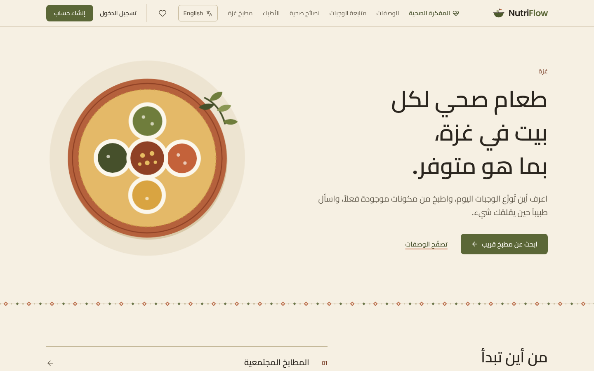

<div align="center" dir="rtl">



[English](README.md) · **العربية**

</div>

<div dir="rtl">

## لماذا هذا المشروع؟

العثور على وجبة ساخنة في غزة لا يجب أن يعتمد على الحظ، والطبخ بما في الخزانة لا يجب أن يعتمد على التخمين.

بنيتُ **نيوتروفلو** ليجمع في مكان هادئ واحد: أين تقدّم التكايا والمطابخ المجتمعية وجباتها اليوم وكم بقي من الأماكن، ووصفات تُطيل عمر المؤن القليلة، ونصائح مبسّطة من أطباء وأخصائيي تغذية، ومتتبّعاً بسيطاً للسعرات الحرارية.

الموقع بالعربية والإنجليزية، يعمل على الهاتف، وبواجهة هادئة عن قصد: ألوان ورقية دافئة، أخضر زيتوني، وأحمر طيني.

## ماذا يقدّم؟

| | |
| --- | --- |
| 🍲 **المطابخ المجتمعية** | وجبة اليوم ووقت التقديم والعدد المتبقي، مع فلترة حسب المنطقة (الشمال، غزة، الوسطى، خانيونس، رفح) و**حجز وجبة الغد**. الحجز يتم داخل معاملة متسلسلة فلا يُحجز أكثر من السعة. |
| 🥘 **وصفات للمؤن القليلة** | خمس عشرة أكلة فلسطينية (فول مدمس، مجدرة، مقلوبة القرنبيط، مسخن وغيرها) مع الوقت والسعرات والقيم الغذائية والمكونات والخطوات، وإمكانية حفظ المفضلة. |
| 📊 **متتبّع الوجبات** | سجّل ما تأكله، حدّد هدفك اليومي (من 800 إلى 6000 سعرة)، وشاهد الشريط يمتلئ، مع عرض شهري بالمتوسط وعدد الأيام الملتزم بها. |
| 🩺 **الأطباء والمواعيد** | تصفّح الأطباء وأخصائيي التغذية، واطلب موعداً، ويصلك إشعار عند تغيّر حالة الطلب. |
| 💧 **نصائح صحية** | ثماني عشرة نصيحة قصيرة: المياه الآمنة، غسل اليدين، الإرواء الفموي، الرضاعة، سوء التغذية، الحمل، السكري والضغط، سلامة الغذاء بلا ثلاجة، والطبخ الآمن. |
| 📍 **تقارير المناطق** | يبلّغ السكان عن حي أو مخيم لا تصله المساعدات، ويراجعها منظّمو المطابخ (قيد الانتظار، تمّت المشاهدة، قيد التحقيق). |

**وأيضاً:** تطبيق ويب قابل للتثبيت (PWA) مع صفحة بلا إنترنت · دعم كامل للاتجاه من اليمين لليسار · تذاكر الدعم · تحسين محركات البحث · حركات خفيفة تتوقف عند طلب المتصفح تقليل الحركة.

## لقطات الشاشة

<p align="center">
  
</p>

انظر [README بالإنجليزية](README.md#a-look-around) لباقي اللقطات.

## التشغيل محلياً

تحتاج إلى **Node.js 22.18 أو أحدث**، وقاعدة بيانات **PostgreSQL**، ومشروع **Supabase** لتسجيل الدخول.

```bash
git clone https://github.com/Ayaalmadhon2004/Healthy-Food.git
cd Healthy-Food

cp .env.example .env     # املأ القيم
npm install              # يشغّل prisma generate أيضاً
npx prisma db push       # إنشاء الجداول
npx prisma db seed       # بيانات تجريبية: وصفات ونصائح وأطباء ومطابخ
npm run dev              # http://localhost:3000
```

الأوامر: `npm run lint` · `npm run typecheck` · `npm test` · `npm run build`

## التقنيات

Next.js 16 (App Router) · React 19 · Tailwind CSS 4 · PostgreSQL مع Prisma 7 · Supabase Auth · Zustand · Zod · Serwist (PWA)

### قرارات تصميم مهمة

- **الهوية من الجلسة.** لا نثق أبداً بمعرّف مستخدم قادم من المتصفح، وإدارة المطابخ والتقارير مقصورة على `ORG` و`ADMIN`.
- **اللغة في الرابط.** كل صفحة تحت `/ar/...` أو `/en/...`.
- **توقيت غزة.** "اليوم" و"الغد" والإحصاءات الشهرية تعتمد `Asia/Gaza`.
- **منع الحجز المزدوج.** معاملات متسلسلة مع إعادة المحاولة، وحدّ 10 طلبات يومياً لكل طبيب.
- **تحديد المعدّل** لحماية تسجيل الدخول وإنشاء الحساب.

## المساهمة

الإضافات الصغيرة والترجمات والوصفات الجديدة مرحّب بها. اقرأ [CONTRIBUTING.md](CONTRIBUTING.md) أولاً. للثغرات الأمنية راجع [SECURITY.md](SECURITY.md).

## الترخيص

[MIT](LICENSE) © آية المدهون

<sub>يقدّم نيوتروفلو إرشادات تغذية عامة ولا يغني عن الطبيب.</sub>

</div>
