<div align="center">


<br>


**[What it does](#what-it-does)** ·
**[A look around](#a-look-around)** ·
**[Run it locally](#run-it-locally)** ·
**[How it's built](#how-its-built)** ·
**[Roadmap](#roadmap)**

</div>

<br>

## Why this exists

Finding a hot meal in Gaza shouldn't depend on luck, and cooking with what's in the cupboard shouldn't depend on guesswork.

I built NutriFlow to put a few small, useful things in one calm place: where the community kitchens are serving today (and how many places are left), recipes that stretch short supplies, plain-language advice from doctors and dietitians, and a simple tracker for people who want to keep an eye on their calories.

It's written in **Arabic and English**, works on a phone, and keeps the interface quiet on purpose: warm paper colours, olive green, clay red, very little noise.

<br>

## What it does

<table>
<tr>
<td width="50%" valign="top">

### 🍲 Community kitchens
See what each kitchen is serving today, at what time, and how many meals are left. Filter by region (North, Gaza, Middle, Khan Younis, Rafah) and **reserve tomorrow's meal** so the kitchen knows how much to cook. Reservations run in a serializable transaction, so a kitchen can't be over-booked by two people at once.

</td>
<td width="50%" valign="top">

### 🥘 Recipes for short supplies
Fifteen Palestinian dishes (foul medames, mujaddara, cauliflower maqluba, musakhan and more) with cooking time, calories, a nutrition breakdown, ingredients and steps. Filter by meal type, then save the ones you like to your favourites.

</td>
</tr>
<tr>
<td valign="top">

### 📊 Meal tracker
Log what you eat, set your own daily calorie goal (800 to 6,000), and watch the bar fill. A monthly view shows your average intake and how many days you stayed on track.

</td>
<td valign="top">

### 🩺 Doctors and appointments
Browse physicians and dietitians, check where they work and when they're available, then request a visit. Doctors confirm or complete requests from their own dashboard, and patients get a notification when the status changes.

</td>
</tr>
<tr>
<td valign="top">

### 💧 Health tips
Eighteen short pieces on safe water, handwashing, oral rehydration, breastfeeding and feeding babies, spotting malnutrition, pregnancy, diabetes and blood pressure with limited food, food safety without a fridge, sleep and stress, and safe cooking fuel.

</td>
<td valign="top">

### 📍 Area reports
Residents can report a neighbourhood or camp that distribution isn't reaching. Kitchen organisers review each report and mark it *pending*, *seen* or *investigated*.

</td>
</tr>
</table>

**Also in the box:** installable PWA with an offline page · full RTL layout for Arabic · support tickets · SEO (sitemap, robots, Open Graph, JSON-LD) · gentle motion that switches off when the visitor asks for reduced motion.

<br>

## A look around

> Every screenshot below was taken from the running app, in its own colours.

### The home page

<p align="center">
  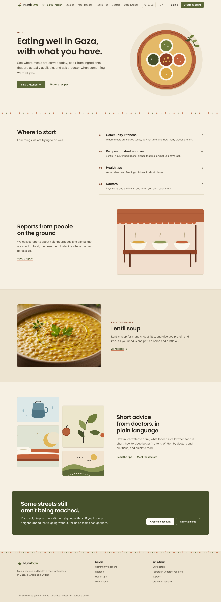
</p>

### Arabic, right to left

<p align="center">
  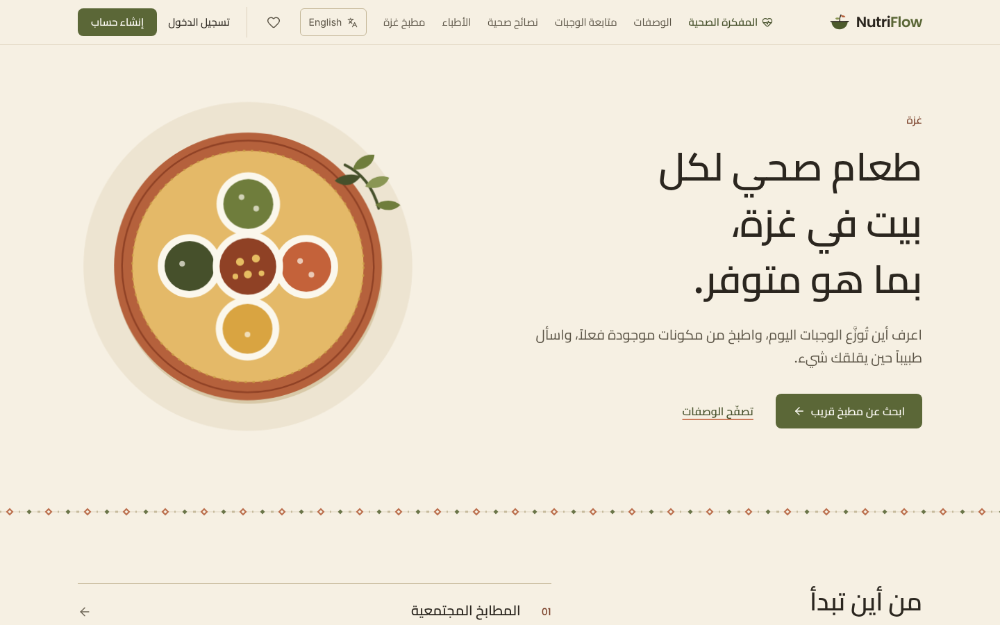
</p>

### Kitchens, recipes, tips and doctors

<table>
<tr>
<td width="50%">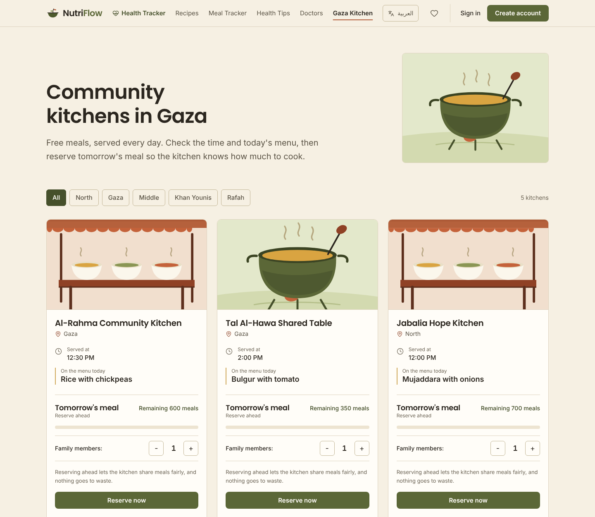<br><sub><b>Community kitchens.</b> Today's menu, serving time, meals left and a reserve button.</sub></td>
<td width="50%">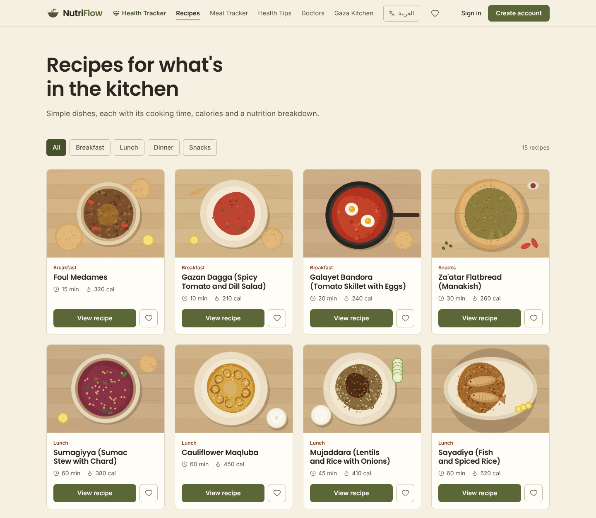<br><sub><b>Recipes.</b> Filter by breakfast, lunch, dinner or snack. Tap the heart to save one.</sub></td>
</tr>
<tr>
<td>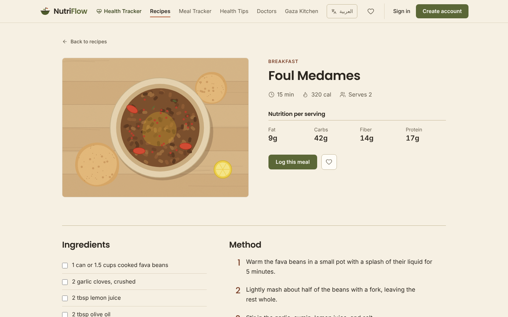<br><sub><b>Recipe detail.</b> Time, calories, nutrition, ingredients and instructions.</sub></td>
<td>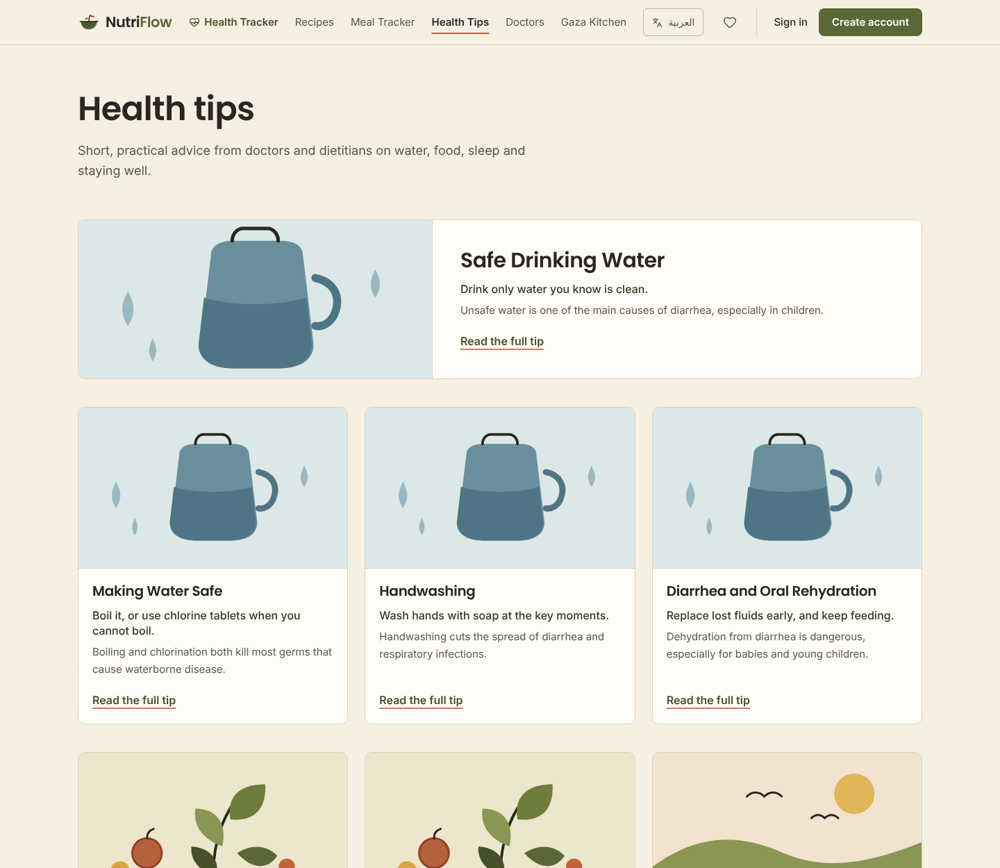<br><sub><b>Health tips.</b> Short, practical and written to be read quickly.</sub></td>
</tr>
<tr>
<td colspan="2">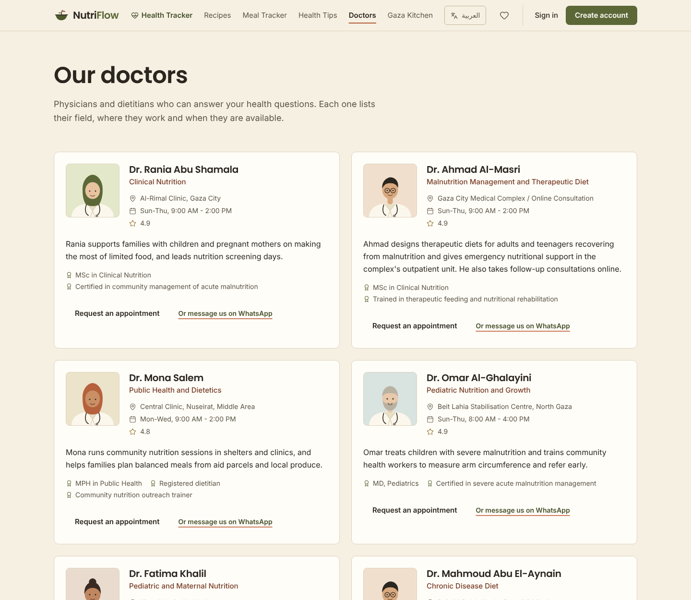<br><sub><b>Doctors.</b> Specialty, workplace, availability, and a button to request an appointment.</sub></td>
</tr>
</table>

### Signed in

<table>
<tr>
<td width="50%">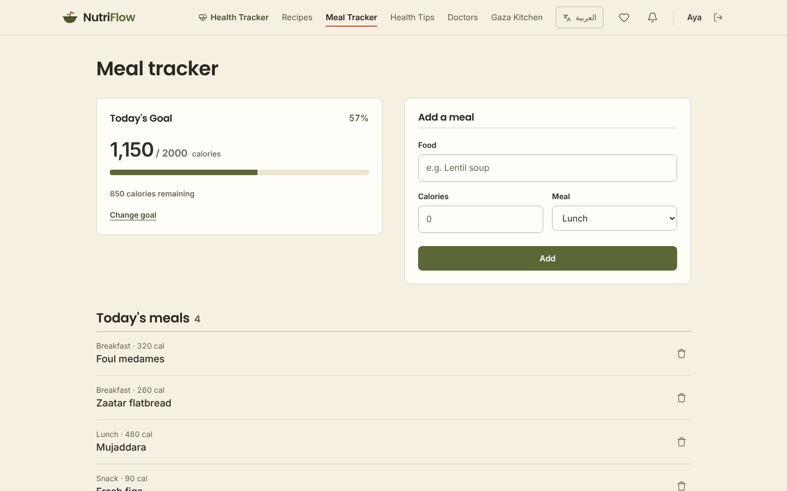<br><sub><b>Meal tracker.</b> Today's goal, a progress bar and the day's meals.</sub></td>
<td width="50%">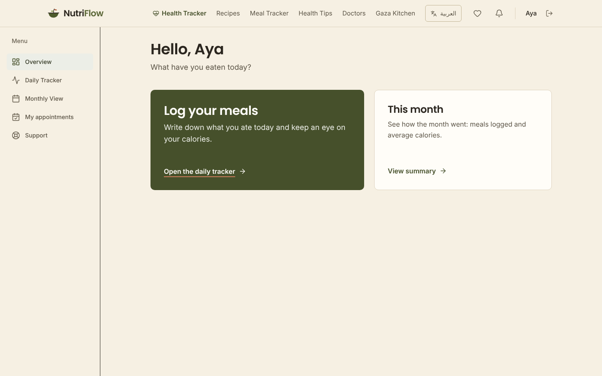<br><sub><b>Dashboard.</b> A small menu that changes with your role.</sub></td>
</tr>
<tr>
<td colspan="2">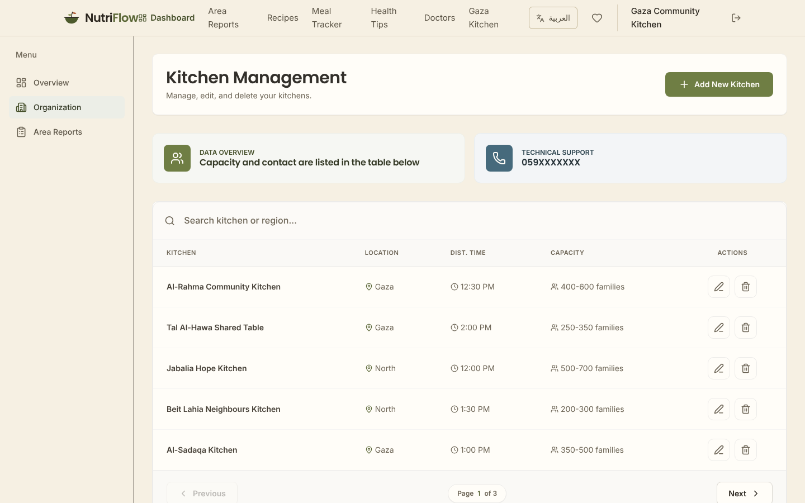<br><sub><b>Kitchen management.</b> Organisers add, edit and remove their kitchens and see capacity at a glance.</sub></td>
</tr>
</table>

<br>

## Run it locally

You'll need **Node.js 22.18 or newer** (the unit tests import TypeScript directly), a **PostgreSQL** database and a **Supabase** project for sign-in.

```bash
git clone https://github.com/Ayaalmadhon2004/Healthy-Food.git
cd Healthy-Food

cp .env.example .env     # then fill in the values below
npm install              # also runs prisma generate
npx prisma db push       # create the tables
npx prisma db seed       # recipes, tips, doctors and kitchens to play with
npm run dev              # http://localhost:3000
```

<details>
<summary><b>Environment variables</b></summary>

<br>

| Variable | What it's for |
| --- | --- |
| `DATABASE_URL`, `DIRECT_URL` | PostgreSQL connection strings (pooled for the app, direct for migrations) |
| `NEXT_PUBLIC_SUPABASE_URL`, `NEXT_PUBLIC_SUPABASE_ANON_KEY` | Supabase client |
| `SUPABASE_SERVICE_ROLE_KEY` | Server only. Used by sign-up to create users |
| `CRON_SECRET` | Required in production for `/api/cron/keep-alive` (`Authorization: Bearer <secret>`) |
| `NEXT_PUBLIC_SITE_URL` | Public origin, used for canonical URLs, Open Graph, sitemap and robots |

</details>

<details>
<summary><b>Scripts</b></summary>

<br>

| Command | What it does |
| --- | --- |
| `npm run dev` | Development server (webpack) |
| `npm run build` · `npm start` | Production build, and server on port 3001. The build reads the seeded database |
| `npm run lint` | ESLint |
| `npm run typecheck` | `tsc --noEmit` for the app and the service worker |
| `npm test` | Unit tests with the Node test runner: dates, capacity, rate limiting, appointments, meals, kitchens, reports, locales and more |

CI (`.github/workflows/ci.yml`) runs lint, typecheck, tests and a build against a throwaway PostgreSQL on every pull request.

</details>

<br>

## How it's built

| | |
| --- | --- |
| **Framework** | Next.js 16 (App Router), React 19, Server Actions and Route Handlers |
| **Styling** | Tailwind CSS 4 with a small set of design tokens (see below) |
| **Data** | PostgreSQL through Prisma 7 |
| **Auth** | Supabase Auth with session cookies. Roles: `USER`, `ORG`, `ADMIN`, `DOCTOR` |
| **State and validation** | Zustand, Zod |
| **Icons and fonts** | Lucide, Inter, Poppins, and Cairo for Arabic (all bundled, no network at build time) |
| **PWA** | Serwist service worker (`app/sw.ts`), generated at build time and disabled in dev |

### A few decisions worth knowing about

- **Identity comes from the session.** Server Actions and API routes read the user from the Supabase session in `lib/auth.ts` and never trust a user id sent by the browser. Kitchen management and area reports are limited to `ORG` and `ADMIN`.
- **Language lives in the URL.** Every page is under `/en/...` or `/ar/...`. A bare path like `/recipes` redirects using the `lang` cookie, then `Accept-Language`, then English. The decision is made in `proxy.ts`.
- **Gaza time.** "Today", "tomorrow" and monthly statistics use the `Asia/Gaza` timezone (`lib/dates.ts`), whatever the server's clock says.
- **No double-booking.** Reservations run in a serializable transaction with retry. Doctors accept at most 10 appointment requests per day, and bookings are limited to the next 60 days.
- **Messy data is welcome.** Kitchen capacity is stored as a number, but older values such as `"350-500 families"` or `{ en, ar }` are still read correctly (`lib/capacity.ts`).
- **Rate limiting** protects login and sign-up (`lib/rateLimit.ts`).

### The look

The palette is warm paper with olive as the working colour and clay for emphasis, with ink instead of pure black. Surfaces are flat and separated by thin lines rather than shadows, radii stay small, and headings never go heavier than semibold. The tokens live in `app/globals.css`.

| Paper | Paper deep | Ink | Olive | Olive light | Clay | Ochre | Sea |
| :---: | :---: | :---: | :---: | :---: | :---: | :---: | :---: |
|  |  |  |  |  |  |  |  |

Motion is kept light: content fades in as you scroll, numbers count up, progress bars fill, hearts pop when you save a recipe. All of it is skipped when the browser asks for reduced motion.

### Project layout

```text
Healthy-Food/
├─ app/                 pages under [lang]/, API routes, Server Actions (app/actions)
├─ components/          shared UI, plus dashboard, kitchen, recipes and tracker pieces
├─ context/ hooks/ store/   language, user and favourites state
├─ lib/                 prisma, supabase, auth, dates, capacity, rate limiting, validation
├─ locales/             en.json and ar.json
├─ prisma/              schema and seed
├─ tests/               unit tests
├─ docs/                README banner and screenshots
├─ public/              images, illustrations, icons, manifest
└─ proxy.ts             language routing, session refresh and route protection
```

<br>

## Roadmap

- [ ] Nutrition plans tailored to a person's health data
- [ ] A space for neighbours to share local health tips
- [ ] Better reports for aid organisations on how distribution is going

<br>

<div align="center">

Made with care by **[Aya Almadhon](https://github.com/Ayaalmadhon2004)**

<sub>NutriFlow shares general nutrition guidance. It does not replace a doctor.</sub>

</div>
